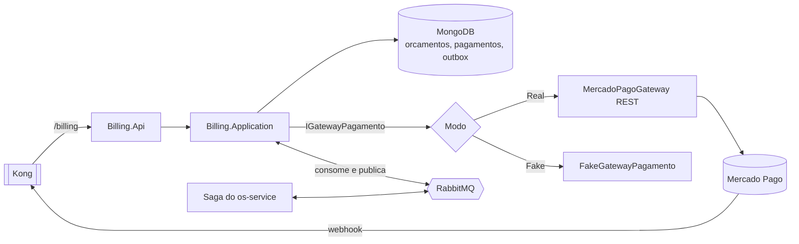

# oficina-billing-service

Orçamento e pagamento (Mercado Pago) da OS — Tech Challenge Fase 4 (SOAT/FIAP). Participa da **Saga orquestrada** do [oficina-os-service](https://github.com/MathboyL3/oficina-os-service) sobre RabbitMQ (MassTransit), com **MongoDB**. Arquitetura geral: [`docs/ARQUITETURA-FASE4.md`](https://github.com/MathboyL3/oficina-os-service/blob/main/docs/ARQUITETURA-FASE4.md) no os-service.

## Responsabilidades

- Gerar o orçamento da OS (validade `Billing:ValidadeOrcamento`, padrão 72 h) e registrar a aprovação/recusa do cliente.
- Criar a cobrança no Mercado Pago (Checkout Pro), receber o webhook, confirmar/recusar o pagamento e **estornar** na compensação.
- Banco próprio: MongoDB `oficina_billing` (coleções `orcamentos`, `pagamentos` e outbox do MassTransit). Nenhum outro serviço o acessa.

## Arquitetura



Camadas: `Billing.Domain` → `Billing.Application` (casos de uso, consumidores, contratos) → `Billing.Infrastructure` (Mongo, MassTransit, gateway MP) → `Billing.Api`. Swagger na raiz `/`.

## Mensagens

Contratos em `src/Billing.Application/Contracts/Mensagens.cs` (namespace `Oficina.Contracts`, idêntico nos 3 repos).

| Consome (comando da Saga) | Efeito | Publica |
|---|---|---|
| `GerarOrcamento` | cria o `Orcamento` Pendente (idempotente por OS) | `OrcamentoGerado` ou `GeracaoOrcamentoFalhou` |
| `CriarCobranca` | cria o `Pagamento` e a preferência no MP; no modo Fake confirma na hora | `CobrancaCriada` (+ `PagamentoConfirmado`/`PagamentoRecusado` no Fake) |
| `CancelarOrcamento` | confere no MP se a OS já foi paga (corrida) e estorna; cancela o orçamento | `PagamentoEstornado`/`EstornoFalhou` (se havia pagamento) e `OrcamentoCancelado` (sempre) |
| `EstornarPagamento` | estorna (idempotente) | `PagamentoEstornado` ou `EstornoFalhou` |

Publicadas por ações externas: `OrcamentoAprovado`/`OrcamentoRecusado` (API aprovar/recusar), `PagamentoConfirmado`/`PagamentoRecusado`/`PagamentoEstornado` (webhook do MP).

## API

Direto: `http://localhost:5002`; via Kong: `http://localhost:32080/billing/api/...`. Coleção Postman: [`docs/oficina-billing-service.postman_collection.json`](docs/oficina-billing-service.postman_collection.json). As rotas de Cliente (orçamentos/pagamentos) usam `{{clienteToken}}`, obtido pela request "Login cliente (CPF)" (Railway Function `fiap-auth-lambda`; o CPF deve estar cadastrado no os-service).

| Método e rota | Acesso |
|---|---|
| `GET /api/orcamentos/{id}`, `GET /api/orcamentos?osId=` | Cliente (só o próprio, senão 403), Atendente, Gerente |
| `POST /api/orcamentos/{id}/aprovar`, `POST /api/orcamentos/{id}/recusar` (`{motivo}`) | Cliente dono (claim `sub` = `ClienteId`), Atendente, Gerente |
| `GET /api/pagamentos/{id}` | Cliente dono, Atendente, Gerente |
| `POST /api/pagamentos/{id}/reprocessar-estorno` | Gerente (só `EstornoPendente`; outro status = 409) |
| `POST /webhooks/mercadopago` (via Kong: `/billing/webhooks/mercadopago`) | anônimo, validado por assinatura |
| `GET /health/live`, `GET /health/ready` | anônimo |

Status: orçamento `Pendente/Aprovado/Recusado/Cancelado`; pagamento `Pendente/Aprovado/Recusado/EstornoPendente/Estornado`.

## Mercado Pago

Integração REST, sem SDK, atrás de `IGatewayPagamento`:
- **Criar cobrança:** `POST /checkout/preferences` com `external_reference` = `OrdemServicoId`, `notification_url` = `{PublicBaseUrl}/webhooks/mercadopago` e `X-Idempotency-Key` = `pref-{OrdemServicoId}` (retomada não duplica a cobrança). Guarda o link (`init_point`, ou `sandbox_init_point` com `Sandbox=true`).
- **Webhook:** `x-signature` = `ts=...,v1=HMAC_SHA256(WebhookSecret, "id:{data.id};request-id:{x-request-id};ts:{ts};")`. Assinatura inválida/ausente ou `ts` malformado/fora da tolerância (5 min) = **401**, sem tocar em nada. Com `data.id` na query (formato do MP) a assinatura é validada antes de ler o corpo. Depois consulta `GET /v1/payments/{id}` (não confia no corpo), localiza o pagamento por `external_reference` e publica o evento. Idempotente: pagamento já final é ignorado; resposta 200.
- **Estorno:** `POST /v1/payments/{id}/refunds` (`X-Idempotency-Key` = `refund-{paymentId}`); consulta o MP antes e, se já estiver `refunded`, só marca `Estornado`.
- **Modo:** `MercadoPago__Modo` = `Real` | `Fake` (padrão `Fake`). No Fake o pagamento é confirmado na hora, sem rede (o gateway Fake não chama o MP) e é **sem estado**: o paymentId é `fake-<PagamentoId sem hífens>` e o status vem só da configuração, então funciona com N réplicas e sobrevive a restart (qualquer instância estorna um pagamento criado por outra). O endpoint de webhook continua **validando a assinatura** (`AssinaturaWebhook`, secret vazio = sempre 401): por isso o `docker-compose.yml` define `MercadoPago__WebhookSecret=dev-webhook-secret-0123456789` e a coleção Postman usa a variável `webhookSecret` com o mesmo valor. Na demo, a request "Webhook MP (exemplo)" deriva `paymentId = fake-<pagamentoId sem hífens>` e responde 200 (pagamento já final, idempotente). No cluster, o segredo vem de `MP_WEBHOOK_SECRET` no `bootstrap-secrets.ps1` (use o mesmo valor de dev para a demo). Para ativar a falha de estorno na demo: `MercadoPago__FakeComportamento=FalharEstorno` (compose, ou chave nova no `k8s/configmap.yaml`) e reiniciar o billing (depois, voltar a `Aprovar` e reiniciar permite `reprocessar-compensacao`/`reprocessar-estorno` estornar o pagamento já criado). `MercadoPago__FakeComportamento` (só Fake) = `Aprovar` | `Recusar` | `FalharEstorno`.

## Configuração

| Chave (env com `__`) | Uso |
|---|---|
| `ConnectionStrings__Mongo` | exige **replica set** (transações + outbox). Local: `mongodb://localhost:27017/?replicaSet=rs0&directConnection=true` |
| `Mongo__Database` | `oficina_billing` |
| `RabbitMq__Host/Port/VirtualHost/Username/Password` | montados campo a campo, nunca por URI |
| `Jwt__Issuer/Audience/Secret` | mesmos do os-service (este serviço só valida o token) |
| `Billing__ValidadeOrcamento` | `72:00:00` |
| `MercadoPago__Modo`, `__FakeComportamento`, `__AccessToken`, `__WebhookSecret`, `__PublicBaseUrl`, `__Sandbox`, `__BaseUrl` | ver acima |

**Segredos:** em produção `Jwt__Secret`, `MercadoPago__AccessToken` e `MercadoPago__WebhookSecret` vêm de variável de ambiente / Secret do Kubernetes. O `Jwt:Secret` de `appsettings.Development.json` é só de desenvolvimento.

## Garantias

- Outbox transacional Mongo: a escrita e as mensagens publicadas confirmam juntas; o inbox descarta reentregas.
- Índice único por OS em `orcamentos` e `pagamentos`; duplicidade vira 409 na API e é tratada como idempotente nos consumidores (que não capturam `DuplicidadeException`: o E11000 aborta a transação e o retry do MassTransit reprocessa pelo caminho idempotente).
- Campo `Versao` nos agregados: gravação otimista (`ReplaceOne` por `Id` + `Versao`); perdeu a corrida = já processado.
- Retry exponencial (3x) nos consumidores; falha técnica vai para a fila `_error` sem disparar compensação.

## Runbook: pagamento após cancelamento e estorno pendente

**Pagamento após cancelamento.** Se o MP aprovar um pagamento cuja OS já foi cancelada/recusada, o billing registra o alerta estruturado `pagamento_apos_cancelamento` (New Relic), marca o pagamento como `EstornoPendente` **antes** de chamar o gateway e estorna automaticamente (publica `PagamentoEstornado`; a Saga já não espera esse pagamento).

**Estorno falho.** Se o estorno falhar, o pagamento fica `EstornoPendente` e é publicado `EstornoFalhou` (a Saga vai a `AguardandoAcaoManual`). Passos:
1. Consultar o painel do Mercado Pago (o MP é a fonte da verdade: já foi estornado lá?).
2. `POST /api/pagamentos/{id}/reprocessar-estorno` (role `Gerente`): consulta o MP antes e, se já estiver `refunded`, apenas marca `Estornado`; se a consulta falhar, tenta estornar mesmo assim. Outro status devolve 409; se falhar de novo, continua `EstornoPendente`.
3. No os-service, `POST /api/admin/ordens-servico/{id}/reprocessar-compensacao` (Gerente) destrava a Saga.

**Risco residual.** Estorno real concluído no MP e **commit local perdido** (o pagamento fica `Pendente`/`EstornoPendente` sem refletir o estorno). É reconciliado pelo próximo webhook do MP (`refunded`), que marca `Estornado`, registra o alerta `estorno_reconciliado` e publica `PagamentoEstornado` (apenas se a OS está cancelada/recusada), ou pelo `POST /api/pagamentos/{id}/reprocessar-estorno`.

## Rodando localmente

Requer Docker. Os 3 serviços compartilham a rede externa `oficina-dev` (os containers se enxergam pelo nome):
1. Uma vez: `docker network create oficina-dev`
2. Suba o **os-service primeiro** (traz o RabbitMQ): `docker compose up -d --build` em `oficina-os-service`
3. Depois `oficina-execucao-service` e `oficina-billing-service` (mesmo comando).

URLs: os `http://localhost:5001`, billing `http://localhost:5002`, execucao `http://localhost:5003` (Swagger em `/`, `/health/ready`). RabbitMQ management: http://localhost:15672 (guest/guest). O compose do billing sobe um MongoDB 7 em replica set (`rs0`, porta 27017) e `MercadoPago__Modo=Fake`.

## Testes e cobertura

`dotnet test Billing.slnx` exige >= 80% de linhas e **precisa de Docker**: `MongoPersistenciaTests` sobe um MongoDB 7 em replica set (Testcontainers) e exercita repositórios, índices únicos, concorrência otimista e o unit of work (commit/rollback) de verdade.

Evidência (execução real de `dotnet test Billing.slnx` em 2026-11-14; 150 testes, 0 falhas):

```
+------------------------+--------+--------+--------+
| Module                 | Line   | Branch | Method |
+------------------------+--------+--------+--------+
| Billing.Api            | 88.23% | 59.09% | 100%   |
+------------------------+--------+--------+--------+
| Billing.Application    | 95.27% | 93.45% | 78.31% |
+------------------------+--------+--------+--------+
| Billing.Domain         | 70.8%  | 68.18% | 66.15% |
+------------------------+--------+--------+--------+
| Billing.Infrastructure | 93.22% | 75.49% | 94.82% |
+------------------------+--------+--------+--------+

+---------+--------+--------+--------+
|         | Line   | Branch | Method |
+---------+--------+--------+--------+
| Total   | 89.47% | 80.26% | 80.63% |
+---------+--------+--------+--------+
| Average | 86.88% | 74.05% | 84.82% |
+---------+--------+--------+--------+
```

Exclusões de cobertura:
- `Program.cs`, `**/DependencyInjection.cs`, `**/Migrations/*.cs`, `**/Persistence/Configurations/*.cs`, `**/*DbContextFactory.cs` (`ExcludeByFile` no csproj de testes; wiring/composição).
- `MessagingExtensions` (`[ExcludeFromCodeCoverage]`): só configura MassTransit/RabbitMQ/outbox; o fluxo mensagem → consumidor → outbox não é exercitado nos testes.

## Deploy no Kubernetes

Pré-requisitos:
- `fiap-infra-k8s` aplicado (namespace `oficina`, RabbitMQ com o Secret `rabbitmq-credentials` e as rotas do Kong).
- Variáveis de ambiente obrigatórias: `JWT_SECRET`, `MP_ACCESS_TOKEN`, `MP_WEBHOOK_SECRET`, `NEW_RELIC_LICENSE_KEY`.
- Opcionais, por ambiente: `MP_MODO` (`Real`/`Fake`), `MP_SANDBOX` (`true`/`false`) e `MP_PUBLIC_BASE_URL`. Vão para o Secret, que sobrepõe o ConfigMap (padrão `Fake`), então o deploy do pipeline não os desfaz.
- `GHCR_USER` e `GHCR_TOKEN` (PAT com `read:packages`) só se os pacotes do GHCR forem privados; hoje são públicos.

Passos (a partir da raiz do repo):
1. `./k8s/bootstrap-secrets.ps1` — cria/atualiza os Secrets (e o `ghcr-pull`, se houver `GHCR_TOKEN`) de forma idempotente (falha se uma env obrigatória estiver vazia). `k8s/secret.example.yaml` documenta as chaves.
2. `kubectl apply -k k8s/`

**Notas:** o Mongo (`billing-mongo`, StatefulSet de 1 nó em replica set) roda **sem autenticação** e só é acessível dentro do cluster. Se o PVC for recriado, reexecute o Job de init do replica set: `kubectl delete job billing-mongo-init -n oficina && kubectl apply -k k8s/`. Acesso externo pelo Kong (NodePort **32080**): `/billing/api/...` e `/billing/webhooks/mercadopago`. `MercadoPago__PublicBaseUrl` aponta para `http://localhost:32080/billing`, o que só serve ao modo Fake: com o Mercado Pago real é preciso um endereço público (túnel, ex.: ngrok/cloudflared) apontando para o proxy do Kong, passado em `MP_PUBLIC_BASE_URL` (ex.: `https://<tunel>/billing`). Com credenciais de vendedor de teste use `MP_SANDBOX=false`: o checkout de teste é o `init_point` normal, pago com um comprador de teste logado. RabbitMQ UI no cluster: NodePort **31672**.

## CI/CD

Pipeline em `.github/workflows/ci-cd.yml` (GitHub Actions).

| Job | Quando | O que faz |
|-----|--------|-----------|
| `build-test-sonar` | PR e push na `main` | restore, build Release, `dotnet test` com gate de cobertura >= 80% (coverlet; sempre ativo) e, se `SONAR_TOKEN` existir, análise SonarCloud com quality gate. Publica o artifact `coverage`. |
| `image` | push na `main` | build da imagem Docker e push para o GHCR (`:<sha>` e `:latest`, nome em minúsculas) via `GITHUB_TOKEN`. |
| `deploy` | push na `main`, após `image` | runner self-hosted (`environment: producao`): fixa a tag `<sha>` no `k8s/kustomization.yaml`, `kubectl apply -k k8s/` e `rollout status`. |

**Secrets/vars necessários**
- `secrets.SONAR_TOKEN` (opcional: sem ele a análise Sonar é pulada), `vars.SONAR_PROJECT_KEY`, `vars.SONAR_ORGANIZATION`.
- Environment `producao` (pode exigir aprovação manual).
- `GITHUB_TOKEN` (automático) com `packages: write` para publicar no GHCR.
- Deploy: runner self-hosted com `kubectl` apontando para o cluster (docker-desktop), `fiap-infra-k8s` aplicado e `k8s/bootstrap-secrets.ps1` já executado.

**Proteger a `main` (passo manual, não configurável por arquivo):** Settings → Branches → Add rule para `main`: *Require a pull request before merging* e *Require status checks to pass* com o check `build-test-sonar`.
